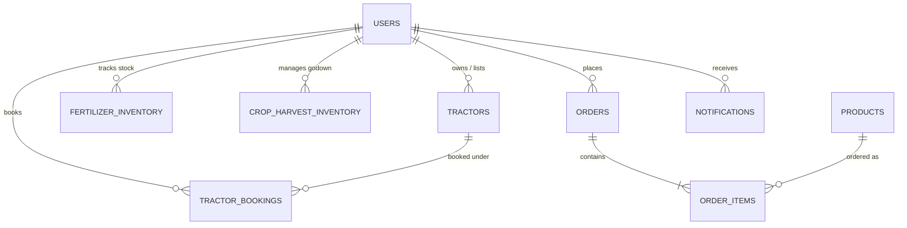

# AgroSmart – Complete Database Architecture & Schema Documentation

This document provides a comprehensive technical reference for the **AgroSmart Database Architecture**, covering both the server-side **MySQL 8.x Relational Database** and the mobile client's **Local SQLite Persistence & Caching Engine**.

---

## 1. Architectural Philosophy: Hybrid Online-Offline Synchronization

Agricultural environments across rural India often present fluctuating mobile network conditions. AgroSmart uses a **Hybrid Database Strategy**:

1. **Server-Side Enterprise Database (MySQL 8.x + Spring Data JPA)**:
   - Serves as the central authoritative data warehouse.
   - Hosted at port `3306` under schema `agrosmart_db`.
   - Manages inter-farmer tractor rentals, market orders, centralized mandi rates, and administrative audits.

2. **Client-Side Offline Engine (SQLite via `AgroSmartDbHelper`)**:
   - Embedded locally on the farmer's Android device (`/data/data/com.agrosmart/databases/agrosmart_local.db`).
   - Automatically synchronizes with local UI views via Android Architecture Components (`LiveData` + `ViewModel`).
   - Ensures farmers can log fertilizer stock, view emergency crop diseases, check harvesting schedules, and compose tractor rental listings with zero latency and zero network reliance.

---

## 2. Entity Relationship Overview

---

## 3. Detailed Data Dictionary (14 Tables)

### Table 1: `users`
Stores authenticated user accounts for both Farmers and Agricultural Administrators.

| Column | Data Type | Nullable | Constraints | Description |
|---|---|---|---|---|
| `id` | BIGINT | No | PK, Auto Increment | Unique internal user sequence identifier |
| `full_name` | VARCHAR(100) | No | - | Farmer or Administrator full legal name |
| `phone` | VARCHAR(15) | No | UNIQUE | 10-digit registered Indian mobile number |
| `email` | VARCHAR(100) | Yes | UNIQUE | Optional registered email address |
| `password` | VARCHAR(255) | No | - | BCrypt salted hash (Cost factor 10) |
| `role` | VARCHAR(20) | No | Default 'ROLE_FARMER' | Role flag (`ROLE_FARMER` or `ROLE_ADMIN`) |
| `village` | VARCHAR(100) | Yes | - | Local village or tehsil name |
| `district` | VARCHAR(100) | Yes | - | District name (e.g. Pune, Nashik, Indore) |
| `state` | VARCHAR(100) | Yes | Default 'Maharashtra'| Indian State |
| `land_area_acres` | DOUBLE | Yes | Default 0.0 | Operational farm landholding in acres |
| `created_at` | TIMESTAMP | Yes | Current Timestamp | Registration audit timestamp |

---

### Table 2: `crop_prices` (Mandi Bhav APMC Rates)
Maintains live and cached commodity market pricing across Indian APMC yards.

| Column | Data Type | Nullable | Constraints | Description |
|---|---|---|---|---|
| `id` | VARCHAR(30) | No | PRIMARY KEY | Unique Mandi record code (e.g. `CP001`) |
| `crop_name` | VARCHAR(100) | No | - | Crop name with multilingual script |
| `category` | VARCHAR(50) | No | - | Crop category (Cereals, Pulses, Oilseeds) |
| `variety` | VARCHAR(100) | Yes | - | Sub-variety (e.g. Sharbati, JS-335) |
| `market_name` | VARCHAR(150) | No | - | APMC Market / Mandi name |
| `state` | VARCHAR(100) | No | - | State where market is located |
| `district` | VARCHAR(100) | Yes | - | District jurisdiction |
| `min_price` | DOUBLE | No | - | Minimum trading auction price in ₹ |
| `max_price` | DOUBLE | No | - | Maximum trading auction price in ₹ |
| `modal_price` | DOUBLE | No | - | Prevailing modal market rate in ₹ |
| `price_unit` | VARCHAR(20) | Yes | Default '₹ / Qtl' | Unit of measurement (per Quintal) |
| `trend` | VARCHAR(10) | Yes | Default 'STABLE' | Price momentum (`UP`, `DOWN`, `STABLE`) |
| `price_change` | DOUBLE | Yes | Default 0.0 | Daily price change delta in ₹ |
| `updated_date` | VARCHAR(50) | Yes | - | Human-readable update timestamp |
| `arrival_quantity`| VARCHAR(50) | Yes | - | Total market volume arrival for the day |

---

### Table 3: `crop_guides` (Cultivation Protocols)
Comprehensive agronomic guidelines developed according to ICAR benchmarks.

| Column | Data Type | Nullable | Description |
|---|---|---|---|
| `id` | VARCHAR(30) | No (PK) | Unique agronomic guide code |
| `crop_name` | VARCHAR(100) | No | Crop name |
| `scientific_name` | VARCHAR(150) | Yes | Botanical scientific classification |
| `season` | VARCHAR(30) | No | Growing season (`Kharif`, `Rabi`, `Zaid`) |
| `duration` | VARCHAR(50) | Yes | Maturity cycle in days |
| `soil_type` | VARCHAR(150) | Yes | Optimal soil texture and pH |
| `water_requirement` | VARCHAR(150) | Yes | Critical irrigation stages |
| `temperature` | VARCHAR(50) | Yes | Temperature threshold range |
| `expected_yield` | VARCHAR(100) | Yes | Estimated harvest yield per hectare |
| `sowing_window` | VARCHAR(100) | Yes | Recommended agricultural calendar dates |
| `harvesting_window` | VARCHAR(100) | Yes | Recommended harvest period |
| `npk_advisory` | TEXT | Yes | N:P:K dosage (kg/ha) and split application |
| `growth_stages` | TEXT | Yes | Sequential vegetative and reproductive stages |
| `best_practices` | TEXT | Yes | Tillage, weed control, and intercultural ops |

---

### Table 4: `crop_diseases` (Scientific Plant Pathology Directory)
Strictly non-AI, expert-verified plant pathology directory.

| Column | Data Type | Nullable | Description |
|---|---|---|---|
| `id` | VARCHAR(30) | No (PK) | Disease identifier |
| `crop_name` | VARCHAR(100) | No | Affected host crop |
| `disease_name` | VARCHAR(150) | No | Common pathology name |
| `causal_organism` | VARCHAR(150) | Yes | Pathogen (fungal, bacterial, viral) |
| `severity` | VARCHAR(20) | Yes | Risk rating (`LOW`, `MEDIUM`, `HIGH`) |
| `symptoms` | TEXT | Yes | Visual diagnostic symptoms on leaf/stem |
| `favorable_conditions`| TEXT | Yes | Temperature and humidity triggers |
| `preventive_measures`| TEXT | Yes | Cultural and prophylactic measures |
| `organic_remedy` | TEXT | Yes | Neem, Trichoderma, cow-urine bio-controls |
| `chemical_control` | TEXT | Yes | Approved CIB&RC fungicide/insecticide dosage |

---

### Table 5: `tractors` (Farm Machinery Fleet)
Rental catalog of farmer-owned tractors and equipment.

| Column | Data Type | Nullable | Description |
|---|---|---|---|
| `id` | VARCHAR(30) | No (PK) | Equipment listing code |
| `model_name` | VARCHAR(150) | No | Brand and model description |
| `brand` | VARCHAR(50) | No | Manufacturer brand |
| `hp` | VARCHAR(20) | No | Engine power (e.g. 50 HP) |
| `hourly_rate` | DOUBLE | No | Base rental rate per working hour |
| `daily_rate` | DOUBLE | No | 8-hour shift rental rate |
| `implements_included`| VARCHAR(255) | Yes | Rotavator, plough, cultivator attachments |
| `owner_name` | VARCHAR(100) | Yes | Listing owner name |
| `owner_phone` | VARCHAR(15) | Yes | Contact phone number |
| `location` | VARCHAR(150) | Yes | Stationed location / Village |
| `is_available` | BOOLEAN | Yes | Active availability toggle |
| `rating` | FLOAT | Yes | Average farmer rating (out of 5.0) |

---

### Table 6: `tractor_bookings` (Machinery Rental Transactions)
Fulfillment and booking log for agricultural machinery.

| Column | Data Type | Nullable | Description |
|---|---|---|---|
| `id` | VARCHAR(40) | No (PK) | Booking reference sequence (e.g. `BK-1001`) |
| `tractor_id` | VARCHAR(30) | No | Referenced tractor identifier |
| `tractor_model` | VARCHAR(150) | No | Snapshot of booked equipment |
| `farmer_name` | VARCHAR(100) | No | Renter farmer name |
| `farmer_phone` | VARCHAR(15) | No | Renter mobile number |
| `booking_date` | VARCHAR(50) | No | Scheduled field operation date |
| `duration_hours` | INT | No | Reserved duration |
| `total_amount` | DOUBLE | No | Calculated rental fee |
| `farm_location` | VARCHAR(255) | No | Farm delivery coordinates / address |
| `notes` | TEXT | Yes | Land preparation notes |
| `status` | VARCHAR(20) | Yes | `PENDING`, `CONFIRMED`, `CANCELLED` |
| `created_at` | VARCHAR(50) | Yes | Transaction creation timestamp |

---

### Table 7: `fertilizer_inventory` (Farmer Input Stock)
Personal on-farm stock management for fertilizers and soil nutrients.

| Column | Data Type | Nullable | Description |
|---|---|---|---|
| `id` | VARCHAR(40) | No (PK) | Inventory line ID |
| `farmer_phone` | VARCHAR(15) | No | Owner farmer mobile number |
| `name` | VARCHAR(150) | No | Fertilizer commercial name |
| `category` | VARCHAR(50) | Yes | Chemical, Organic, Micronutrient |
| `quantity_bags` | INT | No | Unused stock count |
| `bag_weight_kg` | DOUBLE | Yes | Nominal weight per unit |
| `cost_per_bag` | DOUBLE | Yes | Purchase price in ₹ |
| `purchase_date` | VARCHAR(50) | Yes | Acquisition date |
| `low_stock_threshold`| INT | Yes | Trigger point for re-order warning |

---

### Table 8: `crop_harvest_inventory` (Harvest Godown Storage)
Warehouse grain/produce storage records and sales progress.

| Column | Data Type | Nullable | Description |
|---|---|---|---|
| `id` | VARCHAR(40) | No (PK) | Lot / warehouse identifier |
| `farmer_phone` | VARCHAR(15) | No | Farmer phone number |
| `crop_name` | VARCHAR(100) | No | Harvested commodity |
| `variety` | VARCHAR(100) | Yes | Specific seed variety |
| `harvested_quintals` | DOUBLE | No | Total harvested volume |
| `sold_quintals` | DOUBLE | No | Cumulative quantity liquidated |
| `stock_remaining_quintals`| DOUBLE | No | Net stored stock |
| `harvest_date` | VARCHAR(50) | Yes | Date harvested from field |
| `storage_location`| VARCHAR(150) | Yes | Warehouse / Silo designation |
| `expected_price_per_qtl`| DOUBLE | Yes | Target selling price |

---

### Table 9: `products` (Agri Marketplace Catalog)
Certified inputs and equipment available for farmer purchase.

| Column | Data Type | Nullable | Description |
|---|---|---|---|
| `id` | VARCHAR(30) | No (PK) | Catalog SKU code |
| `name` | VARCHAR(150) | No | Commercial product name |
| `category` | VARCHAR(50) | No | Seeds, Fertilizers, Tools, Irrigation |
| `brand` | VARCHAR(100) | Yes | Manufacturer brand |
| `price` | DOUBLE | No | Discounted farmer purchase price |
| `original_price`| DOUBLE | No | Maximum retail price (MRP) |
| `package_size` | VARCHAR(50) | Yes | Physical package volume/mass |
| `description` | TEXT | Yes | Usage instructions and specifications |
| `rating` | FLOAT | Yes | Product customer review score |
| `stock_count` | INT | Yes | Available warehouse inventory |

---

### Table 10 & 11: `orders` and `order_items`
E-Commerce orders and line item relations.

- `orders`: `order_id` (PK), `farmer_phone`, `total_amount`, `payment_method` (`RAZORPAY`, `COD`), `payment_id`, `delivery_address`, `order_date`, `status`.
- `order_items`: `id` (PK, Auto Increment), `order_id` (FK referencing `orders.order_id` with `ON DELETE CASCADE`), `product_id`, `product_name`, `quantity`, `unit_price`, `subtotal`.

---

### Table 12: `government_schemes`
Central and state direct benefit transfers and mechanization subsidies.
- `id`, `title`, `ministry`, `subsidy_amount`, `eligibility`, `description`, `official_url`, `category`, `deadline`.

---

### Table 13: `agri_news`
Agricultural news briefs and government advisories.
- `id`, `title`, `summary`, `content`, `source`, `category`, `published_date`, `read_time`.

---

### Table 14: `notifications`
Direct advisories and transaction updates.
- `id`, `farmer_phone`, `title`, `message`, `timestamp`, `type`, `is_read`.

---

## 4. Security & Data Protection Guarantees

1. **Password Encryption**: All passwords stored in MySQL use industry-standard BCrypt one-way hashing with salt. Plaintext passwords are never persisted.
2. **SQL Injection Defense**: Every backend endpoint uses Spring Data JPA parameterized queries and PreparedStatement bindings.
3. **CORS & Stateless JWT**: REST endpoints support stateless authentication and Cross-Origin Resource Sharing for secure communication.
4. **Resilient Local Fallback**: If the server network fails, the mobile client reads from Android's local SQLite database, ensuring no blank screens or application crashes.
